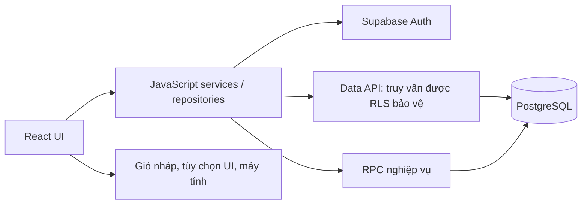

# Tạp hóa BIN — Tổng hợp dự án và kế hoạch Backend

> **Cập nhật 05/10/2026:** phần tổng hợp dưới đây giữ kế hoạch cũ để tham chiếu. Auth/service/repository, cloud nghiệp vụ, legacy import, vốn/lãi/kiểm kê, dashboard và nền tảng Admin đã được bổ sung. Xem [trạng thái triển khai hiện tại](docs/CLOUD_IMPLEMENTATION_STATUS.md) để biết file chịu trách nhiệm, kiểm tra đã chạy và phần chưa nghiệm thu. Không dùng các bước “chưa cài/chưa nối” bên dưới làm trạng thái hiện tại.

Cập nhật: **23/09/2026**. Thư mục dự án: `D:/little_store_fe`.

**Cấu trúc hiện tại ngày 24/09/2026:** FE và BE nằm trong cùng Git repo `D:/little_store_fe`. Supabase, migration, seed, SQL test, tài liệu DB và CLI nằm ở `backend/`; các service/repository/mapper chạy trong trình duyệt vẫn ở `src/`. Xem [README backend](backend/README.md). Lệnh `db:*` chạy được từ thư mục gốc và chuyển tới `backend/`; giữ nguyên `project_id` và không reset dữ liệu khi gộp.

**Bổ sung sau bản tổng hợp:** Đã triển khai lớp nền Supabase giai đoạn 0–1, gồm SDK, Auth/Store service và Repository/Mapper. Xem [trạng thái mới nhất, file và lệnh kiểm tra](docs/BACKEND_PHASE_0_1.md). Các màn hình vẫn dùng demo. Những mục kế hoạch bên dưới mô tả mốc trước khi bổ sung lớp nền này.

Tài liệu này tổng hợp trạng thái đã có trong mã nguồn, những quy tắc nghiệp vụ đã thống nhất và kế hoạch nối backend. Các mục **đã có**, **chưa nối** và **đề xuất làm tiếp** được phân biệt để tránh nhầm giao diện dùng thử với hệ thống đã chạy thật.

## 1. Trạng thái tổng quan

**Frontend đã có các màn hình và luồng thao tác chính, giao diện đã được chỉnh sửa và tối ưu. Database đã có migration cùng RPC nghiệp vụ. Frontend chưa kết nối database.**

| Hạng mục | Trạng thái thực tế |
| --- | --- |
| Giao diện bán hàng, kho, nhập hàng, công nợ, doanh thu | Đã có, hoạt động trên dữ liệu cục bộ. |
| Máy tính và lịch sử tính | Đã có, lưu riêng trong trình duyệt. |
| Đăng nhập/đăng ký | Giao diện mẫu; email chỉ chọn không gian dữ liệu, chưa xác thực thật. |
| Lưu dữ liệu | Zustand + localStorage trên từng trình duyệt. |
| Sao lưu/khôi phục | JSON dữ liệu cục bộ; chưa phải sao lưu DB trực tuyến. |
| Database | Có 3 migration, 14 bảng nghiệp vụ/public, 2 view đọc và 7 RPC nghiệp vụ chính. |
| Backend giao dịch | Đã viết SQL cho bán hàng, nhập kho, trả nợ, hủy đơn; chưa nối với các nút trên giao diện. |
| Supabase client trên frontend | Đã cài SDK, thêm client lazy, Auth/Store service, Repository/Mapper; chưa nối vào màn hình. Xem `docs/BACKEND_PHASE_0_1.md`. |
| Đồng bộ nhiều máy, phân quyền sử dụng thật | Chưa hoàn thiện. |
| Triển khai production | Chưa xác nhận cấu hình hoặc triển khai trong lượt tổng hợp này. |

Các tài liệu cũ có thể ghi tên “Nhà Mình” hoặc ghi chưa xem giao diện bằng trình duyệt. Tên hiển thị hiện tại là **BIN**; đã đối chiếu trực quan một số trang trên desktop và điện thoại trong đợt ngày 23/09. Khóa lưu dữ liệu cũ vẫn giữ nguyên để không làm mất dữ liệu mẫu.

## 2. Mục tiêu sản phẩm

Ứng dụng dành cho chủ tiệm tạp hóa nhỏ, ít rành công nghệ: dễ tìm hàng, tính tiền nhanh, theo dõi kho và ghi nhớ tiền khách mua chịu.

Nguyên tắc cần giữ khi làm BE:

- Giao diện tiếng Việt, thao tác ngắn, nút rõ và đủ lớn.
- Giữ luồng hiện tại; thay nguồn dữ liệu phía sau thay vì viết lại toàn bộ giao diện.
- Tiền, tồn kho và công nợ phải được xác nhận bởi server.
- Một thao tác nghiệp vụ phải thành công toàn bộ hoặc không thay đổi gì.
- Không xóa mất lịch sử khi khách trả hết nợ hoặc khi đơn hàng bị hủy.

## 3. Công nghệ và cấu trúc hiện tại

### 3.1. Công nghệ

Các phiên bản dưới đây là dải phiên bản khai báo trong `package.json`; bản cài chính xác do `package-lock.json` quản lý.

| Phần | Công nghệ |
| --- | --- |
| Giao diện | React `^19.2.8`, JavaScript/JSX. |
| Build/dev server | Vite `^8.3.0`. |
| Điều hướng | React Router DOM `^7.18.4`. |
| State | Zustand `^5.0.15`. |
| Styling | CSS chia module, Tailwind CSS `^4.3.3`. |
| Icon | Lucide React. |
| Font | Plus Jakarta Sans, có font hệ thống dự phòng. |
| Lint/test | Oxlint; Node test runner; script audit UI và benchmark. |
| Nền database | PostgreSQL qua Supabase; migration SQL, pgTAP. |

Project ứng dụng dùng JavaScript. SQL/PLpgSQL trong thư mục Supabase là mã database, không phải TypeScript. Phần lớn UI dùng function component và hook, không phải JavaScript class; `PageErrorBoundary` là một class component.

### 3.2. Cấu trúc chính

```text
little_store_fe/
├── src/
│   ├── App.jsx                       # Khai báo route
│   ├── routePages.js                 # Lazy loading và tải trước theo liên kết
│   ├── layouts/MainLayout.jsx        # Sidebar, header, menu điện thoại
│   ├── pages/                        # Các màn hình nghiệp vụ
│   ├── components/                   # Control, thẻ hàng, hộp thoại, biểu đồ
│   ├── auth/AccountBootstrap.jsx     # Mở hồ sơ mẫu, chặn route theo hồ sơ mẫu
│   ├── stores/                       # State và dữ liệu cục bộ
│   ├── services/accountService.js    # Chuyển hồ sơ mẫu, khôi phục dữ liệu
│   ├── hooks/                        # Tìm kiếm, giới hạn danh sách
│   ├── utils/                        # Quy đổi, CSV, nợ, doanh thu, sao lưu
│   ├── styles/                       # Token, layout và CSS theo tính năng
│   ├── index.css                     # Điểm nhập các module CSS
│   └── motion.css                    # Chuyển động và tối ưu phần hiển thị
├── tests/                            # 20 kiểm thử JavaScript hiện có
├── scripts/                          # Audit UI, benchmark
├── docs/                             # Thiết kế UI, hiệu năng, hướng dẫn kết nối
├── .env.example                      # URL và publishable key mẫu
└── backend/
    ├── package.json                  # Supabase CLI, lệnh db:*
    ├── docs/DATABASE_DESIGN.md
    └── supabase/
        ├── config.toml
        ├── migrations/               # 3 migration hiện có
        ├── seed.sql
        └── tests/store_transactions.test.sql
```

`useShopStore` là store nghiệp vụ đang được các trang chính sử dụng. Khi nối BE cần đi theo luồng đang được import thực tế, không mặc định các file mẫu khác như `useCartStore` hoặc `mockData` là nguồn dữ liệu chính.

## 4. Toàn bộ màn hình và chức năng đã có

| Màn hình/route | Chức năng hiện tại |
| --- | --- |
| Trang chủ `/` | Tổng tiền đã thu hôm nay, tổng nợ, lối vào bán/nhập/nợ/kho, hoạt động gần đây, hàng cần nhập thêm. |
| Máy tính `/calculator` | Cộng, trừ, nhân, chia; số thập phân; dùng bàn phím; xem và dùng lại kết quả. |
| Bán hàng `/sales` | Tìm tên không dấu, lọc nhóm, chọn đơn vị bán, thêm hàng và tăng/giảm số lượng. |
| Giỏ hàng `/cart` | Kiểm tra món, số lượng, đơn vị, tổng tiền; chọn trả ngay hoặc mua chịu; xác nhận giao dịch. |
| Nhập hàng `/import` | Chọn nhóm hàng, thêm hàng mới hoặc nhập thêm hàng đã có. |
| Nhập thêm `/import/existing` | Chọn mặt hàng, đơn vị nhập, số lượng, giá nhập, xem tồn trước/sau; hoàn tác cục bộ khi đủ điều kiện. |
| Thêm hàng `/import/new` | Khai báo tên, nhóm, quy cách, giá và tồn ban đầu. |
| Kho `/inventory` | Tìm kiếm, lọc còn bán/sắp hết/đã hết/ngừng bán, xem tồn và giá, xuất CSV. |
| Sửa hàng `/inventory/:id` | Sửa thông tin, giá, trạng thái bán; có ràng buộc đổi quy cách. |
| Sổ nợ `/debt` | Thêm khách, tìm tên/điện thoại/ghi chú, tổng nợ, xuất danh sách. |
| Chi tiết khách `/debt/:id` | Số nợ, thông tin liên hệ, lịch sử, nhận tiền trả một phần/toàn bộ, bán chịu tiếp. |
| Nhập CSV `/import/csv` | File mẫu cho 6 nhóm, đọc file, kiểm tra, xem trước, xác nhận nhập. |
| Doanh thu `/revenue` | Biểu đồ 7/30/90 ngày; doanh thu, thực thu, công nợ, số đơn; bảng ngày và xuất CSV. |
| Lịch sử `/history` | Lọc bán hàng, nhập hàng, ghi nợ, trả nợ, sửa hàng, hủy đơn và khôi phục. |
| Tài khoản `/account` | Hồ sơ mẫu, xuất JSON, xem trước/khôi phục, giữ bản trước lần khôi phục. |
| Đăng nhập `/login` | Giao diện đăng nhập/đăng ký mẫu, hiện/ẩn mật khẩu, chọn dữ liệu dùng thử. |

### 4.1. Máy tính

- Chỉ các phép toán cơ bản; nhân/chia trước cộng/trừ.
- Phép tính dài tự thu nhỏ chữ để nằm trên một dòng.
- Enter để tính, Esc để xóa; không nhận phím máy tính khi hộp thoại đang mở.
- Giữ tối đa 100 phép tính theo hồ sơ mẫu; bấm kết quả để tính tiếp.
- Lịch sử máy tính lưu riêng, không nằm trong JSON sao lưu cửa hàng.
- Không tác động đến kho, tiền hoặc nợ.

### 4.2. Luồng công nợ đã thống nhất

1. Bấm **Thêm khách**, nhập tên, Enter.
2. Chuyển ngay đến trang chọn hàng của khách đó.
3. Chọn hàng, đơn vị và số lượng, rồi tính tiền.
4. Đơn đi từ khách trong sổ nợ mặc định là **mua chịu**, có giỏ hàng riêng theo khách.
5. Trả một phần: trừ số tiền đã trả, giữ khách trong sổ.
6. Trả hết: khách biến mất khỏi sổ nợ; lịch sử vẫn còn.

**Khác biệt lưu trữ cần nhớ:** FE hiện xóa khách khỏi mảng cục bộ khi hết nợ. DB đã thiết kế giữ bản ghi khách và đặt `is_in_debt_book = false`. UI vẫn có cùng kết quả nhìn thấy, nhưng DB giữ quan hệ với đơn và các lần trả tiền.

### 4.3. Nhóm hàng, giá và quy đổi

| Nhóm | Giá nhập | Giá bán | Quy đổi |
| --- | --- | --- | --- |
| Bánh kẹo | 1 thùng, 1 bịch | Đơn vị bán lẻ được chọn | Số bịch/thùng, số đơn vị/bịch nếu bán nhỏ hơn bịch. |
| Nước | 1 thùng | 1 thùng, 1 lon hoặc 1 chai | Chọn lon/chai và số đơn vị/thùng. |
| Bia | 1 thùng | 1 thùng, 1 lon | Số lon/thùng. |
| Gia vị | Đơn vị nhập được chọn | Cùng đơn vị | Không cần quy đổi đóng gói. |
| Hạt | 1 kg | 1 lạng | 1 kg = 10 lạng; nhập được bội số 0,1 kg. |
| Thuốc lá | 1 cây | 1 cây, 1 gói | Số gói/cây. |
| Hàng khác | Theo đơn vị khai báo | Theo đơn vị khai báo | Hỗ trợ hàng chưa thuộc 6 nhóm trên. |

- Kho lưu theo đơn vị nhỏ nhất; bán thùng và lon cùng trừ một nguồn tồn.
- Không đoán quy cách của hàng cũ. Khi đổi đơn vị phải xác định được hệ số quy đổi.
- FE chặn đổi quy cách khi sản phẩm đang trong giỏ; sản phẩm đã có quy cách và còn tồn bị hạn chế thay đổi.
- Lịch sử giữ tên, đơn vị, giá và số lượng quy đổi tại lúc giao dịch.
- Nhập thêm có giá của từng lần nhập. Nút hoàn tác hiện xuất hiện trong 12 giây; đây là hành vi của FE, chưa có RPC tương đương.

### 4.4. CSV

- UTF-8, tối đa 2 MB, từ 1 đến 2.000 mặt hàng.
- Cột cơ bản: `Tên hàng`, `Giá bán`, `Số lượng`, `Đơn vị`; `Loại hàng` tùy chọn.
- Có thể dùng `Số lượng nhập` hoặc `Còn lại` thay cho `Số lượng`.
- Có file mẫu riêng cho các nhóm, kèm quy cách và các mức giá.
- Tên trùng cộng thêm tồn theo quy cách đang có, không tự ghi đè giá hiện tại.
- Quy cách không khớp kho bị từ chối; tên mới tạo mặt hàng mới.
- **Nạp lại CSV xuất kho sẽ cộng thêm tồn, không thay thế tồn hiện có.**
- CSV hàng hóa không phải bản sao lưu đầy đủ của cửa hàng.

### 4.5. Tiền và doanh thu

| Chỉ số | Công thức nghiệp vụ |
| --- | --- |
| Doanh thu | Bán trả ngay + bán chịu − giá trị đơn hủy trong kỳ. |
| Thực thu | Tiền bán trả ngay + tiền khách trả nợ − tiền hoàn khi hủy. |
| Công nợ hiện tại | Số dư còn nợ của khách tại thời điểm xem. |
| Số đơn | Không tính đơn đã hủy theo quy tắc hiện tại. |

Thu nợ không được cộng lại vào doanh thu. Nợ ban đầu không phải doanh thu mới. Hủy đơn của kỳ trước có thể làm số liệu kỳ hiện tại âm. Hiện chưa tính lợi nhuận/giá vốn hoặc chi phí vận hành.

### 4.6. Hủy đơn

- Hủy toàn bộ đơn, nhập lý do, xem trước hàng hoàn, nợ giảm và tiền hoàn.
- Có bước xác nhận đã nhận lại hàng và đã hoàn tiền cần hoàn.
- Đơn trả ngay: hoàn kho và ghi tiền hoàn.
- Đơn mua chịu: giảm phần còn nợ, hoàn phần đã trả; không làm thay đổi phân bổ đã ghi nhận của các đơn khác.
- Không hủy lần hai. Giữ đơn gốc với trạng thái hủy và thêm lịch sử riêng.
- Đơn mẫu/cũ thiếu chi tiết mặt hàng không tự động hoàn kho.
- Đây là ghi nhận tiền hoàn, không phải tích hợp chuyển khoản hay cổng thanh toán.

### 4.7. Tài khoản, sao lưu và dữ liệu cục bộ

- Khóa mẫu: `nha-minh-demo-v1`; hồ sơ email: `little-store-profile:<email đã mã hóa>`.
- Email không chứng minh danh tính và không phải cơ chế phân quyền.
- Mật khẩu mẫu không được lưu hay gửi đi.
- JSON sao lưu gồm hàng, quy cách, giá, khách, lịch sử và giỏ hàng; giới hạn 8 MB cho dữ liệu được kiểm tra.
- Có kiểm tra cấu trúc/checksum, xem trước, xác nhận và giữ bản trước khi khôi phục. Checksum không thay thế chữ ký hay xác thực nguồn file.
- Chưa có đồng bộ nhiều thiết bị, offline queue hoặc PWA hoàn chỉnh.

## 5. Giao diện và hiệu năng đã nâng cấp

### 5.1. Thiết kế

- Dashboard tối giản, nền xám xanh nhẹ, mặt thẻ trắng, xanh đậm cho hành động chính, hổ phách cho công nợ.
- Khoảng cách thành phần chung theo 4/8px; bo góc 8/12/16/24px; border 1px và bóng nhiều lớp nhẹ.
- Tiêu đề 26–32px; nội dung 14–16px; nút chính/ô nhập cao 48px, nút biểu tượng 44px.
- Trạng thái focus rõ, hỗ trợ giảm chuyển động, bố cục desktop và điện thoại.
- Skeleton, thông báo tải lỗi, hộp thoại có nhãn truy cập và quản lý focus/cuộn.

### 5.2. Chuyển động và xử lý dữ liệu

- Chỉ animate `transform`/`opacity`; hover/tap 180ms, biểu đồ 240ms, hộp thoại 340ms.
- Easing `cubic-bezier(0.16, 1, 0.3, 1)`; biểu đồ dùng `scaleY`, không animate chiều cao.
- Lazy loading theo trang; tải trước theo liên kết đang trỏ chuột/focus.
- Thẻ sản phẩm chỉ theo dõi lượng hàng liên quan; giảm render lại khi đổi giỏ.
- Tìm kiếm có chỉ mục tên không dấu và ưu tiên phản hồi nhập chữ.
- Danh sách ban đầu có giới hạn và nút Xem thêm; `content-visibility` giảm công bố cục/vẽ ngoài vùng nhìn. Đây không phải virtual list xóa DOM ngoài màn hình.
- Dùng lại bộ định dạng tiền/ngày, bảng tra sản phẩm và JSON của các phần dữ liệu chưa đổi.
- Không cập nhật/lưu lại nếu số lượng không đổi. Vẫn lưu đồng bộ, không trì hoãn ghi giao dịch.
- Máy tính giảm số lần đo chữ, không đăng ký lại listener bàn phím theo từng phím.

### 5.3. Kết quả kiểm tra đã ghi nhận

| Kiểm tra | Kết quả gần nhất được ghi nhận |
| --- | --- |
| Build / lint | Đạt ở đợt nâng cấp UI ngày 23/09. |
| JavaScript tests | 20 bài đạt. |
| Audit UI | 45 transition và 3 keyframe được kiểm tra chính sách chuyển động; 10 cặp màu chính đạt ít nhất 4,5:1. |
| Xem trực quan | Trang chủ desktop/390px, bán hàng 390px, doanh thu desktop, máy tính, hộp thoại hướng dẫn. |
| Benchmark tạo JSON | Với 2.000 sản phẩm, 10.000 giao dịch, 100 lần đổi giỏ: trung vị 8,548 ms → 0,741 ms. |
| SQL tests | File pgTAP hiện khai báo 23 assertion; không chạy lại DB test trong lượt viết tài liệu này. |

Benchmark chỉ đo tạo JSON bằng Node sau khi làm nóng cache, không gồm ghi localStorage hay FPS. Audit màu chính không phải chứng nhận WCAG toàn ứng dụng. **Chưa đo để xác nhận 60 FPS trên thiết bị thực tế.** Các kiểm tra trên là kết quả các đợt trước; lượt này rà nguồn và viết tài liệu, không tự reset DB.

## 6. Bản đồ file phụ trách

| Nhóm | File / hàm chính |
| --- | --- |
| Điều hướng | `src/App.jsx`, `src/routePages.js`, `src/layouts/MainLayout.jsx`. |
| Bán hàng | `src/pages/SalesPages.jsx`, `src/components/SaleProductCard.jsx`. |
| Nhập và kho | `src/pages/StockPages.jsx`, `src/components/PricingFields.jsx`. |
| Công nợ, lịch sử | `src/pages/DebtPages.jsx`. |
| CSV | `src/pages/CsvImportPage.jsx`, `src/utils/stockCsv.js`. |
| Quy đổi, giá, giỏ | `src/utils/productPricing.js`: `saleOptions`, `purchaseOptions`, `baseQuantity`, `cartLines`. |
| Nợ và hủy đơn | `src/utils/saleCancellation.js`: `allocatePayment`, `cancellationPlan`, `applySaleCancellation`; `src/components/SaleCancellationDialog.jsx`. |
| Doanh thu | `src/utils/revenue.js`: `summarizeRevenue`; `src/pages/RevenuePage.jsx`; `src/components/reports/RevenueChart.jsx`. |
| Máy tính | `src/pages/CalculatorPage.jsx`, `src/utils/calculator.js`, `src/pages/calculator.css`. |
| Tài khoản hiện tại | `src/pages/LoginPage.jsx`, `src/pages/AccountPage.jsx`, `src/auth/AccountBootstrap.jsx`, `src/services/accountService.js`. |
| Sao lưu | `src/utils/backup.js`: `snapshotOf`, `validateSnapshot`, `createBackup`, `parseBackup`. |
| State hiện tại | `src/stores/useShopStore.js`, `src/stores/useAccountStore.js`. |
| Tối ưu | `src/utils/cachedStorage.js`, `src/utils/productLookup.js`, `src/hooks/useProductSearch.js`, `src/hooks/useListWindow.js`. |
| UI chung | `src/components/ui.jsx`, `src/components/feedback/Dialog.jsx`, `src/components/PageLoading.jsx`. |
| Thiết kế | `src/styles/tokens.css`, `src/styles/polish.css`, các CSS theo tính năng, `src/styles/responsive.css`, `src/motion.css`. |
| Kiểm tra | `tests/account-and-cancellation.test.js`, `tests/calculator.test.js`, `tests/performance-storage.test.js`, `scripts/audit-ui.mjs`, `scripts/benchmark-ui.mjs`. |

## 7. Database đã có

### 7.1. Migration và cấu hình

| File | Nội dung |
| --- | --- |
| `D:/little_store_fe/backend/supabase/migrations/202609210001_initial_store_schema.sql` | Bảng, constraint, index, trigger, RLS, quyền truy cập, tạo cửa hàng. |
| `D:/little_store_fe/backend/supabase/migrations/202609210002_transaction_functions.sql` | Nhập kho, bán hàng, trả nợ, hủy đơn, view đọc. |
| `D:/little_store_fe/backend/supabase/migrations/202609210003_catalog_functions.sql` | Tạo/sửa sản phẩm và khách. |
| `D:/little_store_fe/backend/supabase/seed.sql` | Dữ liệu thử theo nhóm hàng. |
| `D:/little_store_fe/backend/supabase/tests/store_transactions.test.sql` | Bộ test SQL hiện có. |

Cổng local khai báo trong cấu hình: API `54321`, PostgreSQL `54322`, Studio `54323`, hộp thư thử `54324`. Đây là cấu hình trong file, không khẳng định các dịch vụ hiện đang chạy. Supabase local chạy qua Docker; PostgreSQL cài riêng trên Windows không tự biến thành môi trường Supabase này.

### 7.2. Các bảng và view

| Nhóm | Bảng | Vai trò |
| --- | --- | --- |
| Tài khoản/cửa hàng | `profiles`, `stores`, `store_members` | Người dùng, cửa hàng, thành viên owner/staff. |
| Danh mục | `products`, `product_units` | Tên, nhóm, tồn nhỏ nhất, trạng thái và giá/quy đổi theo đơn vị. |
| Khách | `customers` | Thông tin, nợ hiện tại, trạng thái trong sổ nợ. |
| Bán hàng | `sales`, `sale_items` | Đơn và snapshot chi tiết tại thời điểm bán. |
| Nhập kho | `stock_receipts`, `stock_receipt_items` | Phiếu nhập, số lượng, giá nhập từng lần. |
| Sổ kho | `stock_movements` | Biến động tăng/giảm và số dư sau thao tác. |
| Thu nợ | `debt_payments`, `payment_allocations` | Phiếu trả tiền và phân bổ vào từng đơn. |
| Dấu vết | `audit_logs` | Ai làm gì, trên đối tượng nào, lúc nào. |
| View | `product_catalog`, `customer_debt_summary` | Ghép dữ liệu đọc; sử dụng quyền của người gọi. |

Tiền dùng `bigint` theo đồng; tồn dùng số nguyên theo đơn vị nhỏ nhất. Cửa hàng có múi giờ mặc định `Asia/Ho_Chi_Minh`. Bảng nghiệp vụ gắn `store_id`, nhiều quan hệ có khóa ngoại kết hợp để ngăn ghép dữ liệu khác cửa hàng.

### 7.3. RPC nghiệp vụ hiện có

| RPC | Input quan trọng | Kết quả |
| --- | --- | --- |
| `create_store` | `p_name` | ID cửa hàng, người gọi thành owner. |
| `save_product` | Cửa hàng, tên/nhóm, base unit, danh sách units, tồn mở đầu, ID khi sửa | UUID sản phẩm. |
| `save_customer` | Cửa hàng, tên, điện thoại, ghi chú, ID khi sửa | UUID khách; không cho client gán số nợ tùy ý. |
| `receive_stock` | `p_store_id`, `p_request_id`, `p_items`, `p_note` | `receipt_id`, thông tin kết quả; tối đa 500 dòng/lần. |
| `create_sale` | `p_store_id`, `p_request_id`, `p_items`, `p_payment_type`, `p_customer_id` | `sale_id`, `total_amount`, `duplicate`; tối đa 200 dòng. |
| `record_debt_payment` | Cửa hàng, khách, tiền, request ID, cách nhận, ghi chú | `payment_id`, `remaining_debt`, `duplicate`. |
| `cancel_sale` | Cửa hàng, đơn, lý do | `sale_id`, `refund_amount`, `debt_reduction`. |

Các hàm ghi nghiệp vụ dùng transaction của PostgreSQL, khóa các dòng liên quan và có kiểm tra thành viên. `receive_stock`, `create_sale`, `record_debt_payment` có request ID chống tạo giao dịch trùng. `cancel_sale` hiện ngăn hủy lần hai bằng trạng thái đơn, chưa có cùng cơ chế request ID như ba hàm kia.

Mọi bảng public đã bật RLS; các bảng tiền/kho/nợ không mở quyền ghi trực tiếp cho FE. Tuy nhiên, các RPC hiện chủ yếu kiểm tra **thành viên**, chưa thực thi đầy đủ ma trận owner/staff dự kiến bên dưới.

## 8. Kiến trúc BE đề xuất

**Tiếp tục Supabase Auth + PostgreSQL + RPC cho MVP**, tận dụng phần đã có. Không cần tạo thêm một server Express chỉ để chuyển tiếp nguyên các lệnh vào DB.



Database Functions có thể được gọi qua API/client; RLS kiểm soát quyền đọc theo người dùng. Đây là cơ sở cho phương án trên; lựa chọn tận dụng nó là đề xuất riêng cho mã nguồn hiện tại. Tham khảo [Database Functions](https://supabase.com/docs/guides/database/functions) và [Row Level Security](https://supabase.com/docs/guides/database/postgres/row-level-security).

FE chỉ chứa URL và publishable key; secret/service-role key thuộc môi trường server, không được đưa vào biến `VITE_*`. Publishable key không thay thế đăng nhập và RLS. Xem [API keys của Supabase](https://supabase.com/docs/guides/getting-started/api-keys).

Nếu sau này cần webhook thanh toán, tích hợp hóa đơn, tác vụ nền hoặc xử lý file lớn, bổ sung một dịch vụ Node.js bằng JavaScript. Dịch vụ đó vẫn dùng giao dịch DB đã thống nhất, không nhân đôi toàn bộ logic tiền/kho ở nhiều nơi. Kế hoạch hiện tại không đổi frontend sang TypeScript.

## 9. Cách nối FE để giữ giao diện hiện tại

### 9.1. Cấu trúc cần tạo — CHƯA CÓ

```text
src/
├── lib/supabase.js                  # Client và kiểm tra cấu hình
├── services/
│   ├── authService.js               # Đăng nhập thật, phiên, đăng xuất
│   ├── storeService.js              # Cửa hàng đang dùng, thành viên
│   ├── productService.js            # Đọc danh mục, tạo/sửa hàng
│   ├── inventoryService.js          # Nhập hàng và hoàn tác hợp lệ
│   ├── salesService.js              # Bán, xem đơn, hủy
│   ├── customerService.js           # Khách và thu nợ
│   ├── reportService.js             # Dashboard, doanh thu, lịch sử
│   └── importService.js             # CSV, nhập dữ liệu cục bộ
├── repositories/
│   ├── demoShopRepository.js        # Giữ chế độ dùng thử
│   └── supabaseShopRepository.js    # Dữ liệu thật
├── mappers/                        # Đổi cấu trúc DB thành model màn hình
├── hooks/                          # Đọc dữ liệu, phân trang, loading/error
└── stores/                         # Chỉ giữ phiên/UI/giỏ nháp và cache phù hợp
```

Đây là cấu trúc dự kiến, không phải các file đã được triển khai. Đặt một giao diện repository dùng chung để từng màn hình được chuyển dần. Chế độ demo và dữ liệu thật phải tách rõ; khi API lỗi, không tự rơi về demo rồi báo đã lưu.

### 9.2. Bảng chuyển đổi quan trọng

| FE hiện tại | DB / cách xử lý khi nối |
| --- | --- |
| `product.stock` | `products.stock_base`. |
| `product.unit` | `products.base_unit`. |
| `product.price`, `product.pricing` | Ghép từ `product_units`; không bỏ qua đơn vị pack/bag. |
| `customer.totalDebt` | `customers.current_debt`. |
| `lastTransactionAt` | `last_transaction_at`. |
| Thanh toán `'debt'` | RPC dùng `'credit'`; trả ngay dùng `'cash'`. |
| ID mẫu dạng `'1'`, `'c1'` | DB dùng UUID; khi nhập dữ liệu phải lập bảng đối chiếu ID. |
| Một mảng `entries` | Cần API/view lịch sử ghép từ nhiều bảng, không chỉ đọc `sales`. |
| Xóa khách trả hết | Ẩn khỏi sổ nợ bằng trạng thái; đọc chi tiết đơn vẫn giữ customer ID. |
| `undoStock` | Cần RPC hoàn tác mới, chưa được thay bằng `receive_stock` số âm. |
| Giỏ cục bộ | Có thể giữ bản nháp theo `user_id + store_id + customer_id`; DB kiểm tra lại lúc chốt. |
| `summarizeRevenue(entries)` | Thay nguồn bằng tổng hợp phía DB, không kéo toàn bộ lịch sử để tính. |

### 9.3. Quy tắc phản hồi UI khi gọi BE

- Giữ giỏ và nội dung form khi request lỗi; chỉ xóa giỏ khi đã xác nhận kết quả thành công.
- Nút đang gửi có trạng thái bận và chống bấm lặp; thông báo phân biệt mất mạng, hết phiên, thiếu quyền, giá/tồn đã đổi.
- Không cập nhật tiền/kho theo kiểu optimistic rồi giả định đã lưu. Có thể phản hồi bấm nút ngay nhưng số liệu chính thức lấy từ server.
- Sau giao dịch, làm mới các phần liên quan: tồn, khách, đơn, tổng tiền, lịch sử; không reload toàn trang.
- Hủy request đọc cũ hoặc bỏ qua response cũ khi người dùng đổi cửa hàng/bộ lọc để tránh hiển thị nhầm dữ liệu.
- Khi đăng xuất/đổi cửa hàng, xóa cache dữ liệu server của phiên cũ và tách các giỏ nháp đúng chủ.

## 10. Các phần BE còn thiếu hoặc cần gia cố

| Ưu tiên | Khoảng trống | Việc cần làm |
| --- | --- | --- |
| P0 | Xác thực thật chưa nối | Client Supabase, đăng nhập/đăng ký, refresh phiên, đăng xuất, xử lý hết phiên. |
| P0 | Chưa có luồng chọn/tạo cửa hàng thật | Tạo store, nạp memberships, chọn store đang dùng, xử lý tài khoản chưa có store. |
| P0 | Retry chưa kiểm tra cùng ID nhưng khác payload | Lưu fingerprint payload; request trùng đúng nội dung trả kết quả cũ, nội dung khác bị từ chối. |
| P0 | Chưa thống nhất quyền owner/staff | Quyền phía DB/RPC; không chỉ ẩn nút trên FE. |
| P0 | Ràng buộc input chưa được kiểm thử đủ | NULL/thiếu field, loại JSON, số lẻ/âm, đơn vị không hợp lệ, tràn số và giới hạn JS. |
| P0 | Giá/tồn có thể đổi giữa xem giỏ và chốt | Thêm kiểm tra version/giá kỳ vọng hoặc bước báo thay đổi để người bán xác nhận lại. Server vẫn tự tính giá. |
| P0 | Chưa có báo cáo/lịch sử thống nhất phía server | View/RPC phân trang, tổng hợp theo múi giờ cửa hàng, xử lý hủy đơn/nợ ban đầu đúng công thức. |
| P1 | FE có hoàn tác nhập nhưng DB chưa có RPC | Giao dịch bù, trạng thái phiếu, điều kiện cho phép, khôi phục giá đúng khi không có thao tác mới. |
| P1 | CSV FE 2.000 dòng; nhập kho RPC chỉ 500 | Thiết kế batch import riêng có validate/preview/commit; không âm thầm nhập một phần. |
| P1 | CSV hỗ trợ tạo hàng mới | RPC batch phải tạo danh mục và nhập kho đúng một lần; vòng lặp gọi từng RPC không có rollback toàn file. |
| P1 | Dữ liệu mẫu/nợ mở đầu khác schema DB | Quy trình migration và mô hình nợ ban đầu, đối soát số dư, không làm tăng doanh thu giả. |
| P1 | Khách mới chưa có nợ | DB mặc định không ở sổ nợ; sau thêm phải mở khách bằng ID. Nếu cần giữ danh sách khách chờ mua, bổ sung trạng thái nháp riêng. |
| P1 | Hủy đơn khi response thất lạc | Trả/tra lại kết quả hủy đã có, không hoàn lần hai; chuẩn hóa lỗi và trạng thái giao dịch. |
| P1 | Nhiều máy bán/trả/hủy cùng lúc | Kiểm thử đồng thời, thứ tự khóa thống nhất, xử lý retry khi serialization/deadlock. |
| P1 | Sao lưu/khôi phục trực tuyến chưa có | Xuất dữ liệu theo quyền, snapshot nhất quán, xác thực file phía server, quy trình khôi phục có audit. |
| P2 | Offline và tích hợp ngoài | Làm sau khi giao dịch online đã ổn định; chưa đưa vào MVP đầu tiên. |

Rà riêng `save_product`: bảo đảm quy tắc đóng gói theo từng nhóm và việc đổi quy cách có lịch sử được kiểm tra đầy đủ ở server, không chỉ dựa vào form FE. Cột `version` đã có nhưng RPC sửa hiện chưa nhận expected version để chống ghi đè thay đổi đồng thời.

## 11. Kế hoạch triển khai theo giai đoạn

Mỗi giai đoạn phải có mã, migration cần thiết và kiểm thử tương ứng trước khi chuyển sang phần sau. Hoàn thành luồng thực tế bằng DB local ngay từ đầu, không viết toàn bộ BE trên dữ liệu giả rồi mới gắn DB cuối cùng.

### Giai đoạn 0 — Chuẩn bị môi trường và khóa quy tắc

- [ ] Chạy Supabase local bằng Docker; áp dụng migration và seed trên DB phát triển riêng.
- [ ] Chạy lại bộ pgTAP hiện có; ghi kết quả làm mốc.
- [ ] Chốt ma trận quyền, quy tắc nhập CSV, hoàn tác, nợ ban đầu và trả lại dữ liệu khi retry.
- [ ] Rà input validation, quyền execute, RLS, khóa ngoại khác cửa hàng và thứ tự khóa.
- [ ] Tạo migration mới cho sửa đổi; không sửa lịch sử migration đã áp dụng lên môi trường chung.

**Nghiệm thu:** dựng DB mới từ mã nguồn được; test nền chạy được; hai cửa hàng không đọc/ghi dữ liệu của nhau.

### Giai đoạn 1 — Auth, cửa hàng và lớp truy cập dữ liệu

- [ ] Cài `@supabase/supabase-js`; tạo client qua cấu hình môi trường.
- [ ] Nối login/register/session/logout; cấu hình xác nhận email và reset mật khẩu nếu bật.
- [ ] Tạo/chọn cửa hàng qua membership thật.
- [ ] Tách repository demo/cloud; thêm mapper và loading/error chuẩn.
- [ ] Thay bootstrap/gate mẫu bằng kiểm tra phiên thật trong chế độ cloud.

**Nghiệm thu:** đăng nhập, tải lại, đăng xuất hoạt động; tài khoản chưa có store được dẫn vào tạo store; cache không lẫn giữa tài khoản.

### Giai đoạn 2 — Danh mục, khách và nhập kho cơ bản

- [ ] Đọc `product_catalog`, `customer_debt_summary` với phân trang và lọc server.
- [ ] Nối `save_product`, `save_customer`, `receive_stock`.
- [ ] Mapper giữ đủ 6 nhóm, pack/bag/base và số lượng quy đổi.
- [ ] Sau thêm khách, chuyển đúng vào trang chọn hàng cho UUID vừa tạo.
- [ ] Thêm tìm không dấu phía server để tìm trên toàn bộ kho, không chỉ trang dữ liệu đã tải.

**Nghiệm thu:** thêm hàng, sửa giá, nhập thùng/bịch/kg/cây; tải lại vẫn đúng. Các lỗi quy cách trả thông báo rõ, tồn không bị cộng khi thất bại.

### Giai đoạn 3 — Bán hàng thật và xử lý mạng lỗi

- [ ] Nối `create_sale` cho trả ngay và mua chịu.
- [ ] UUID request gắn với lần xác nhận; dùng lại khi gửi lại cùng giao dịch.
- [ ] Giải quyết giá/phiên bản thay đổi trước khi chốt; giữ giỏ khi không đủ tồn.
- [ ] Lưu trạng thái request chưa rõ kết quả để tra cứu sau timeout hoặc reload.
- [ ] Làm mới các cache liên quan sau khi DB đã commit.

**Nghiệm thu:** hai máy tranh lượng tồn cuối không bán vượt kho; gửi lặp không trừ kho hai lần; mất response rồi gửi lại vẫn chỉ có một đơn.

### Giai đoạn 4 — Trả nợ, hủy đơn và hoàn tác nhập

- [ ] Nối `record_debt_payment`, phân bổ vào đơn cũ trước.
- [ ] Trả hết ẩn khách, trả một phần giữ khách; lịch sử vẫn truy xuất được.
- [ ] Nối preview hủy và `cancel_sale`, kiểm tra lại kết quả tiền hoàn/nợ giảm phía server.
- [ ] Bổ sung RPC hoàn tác nhập và quyền thực hiện.
- [ ] Kiểm thử trả nợ/hủy đơn đồng thời, hủy đơn đã trả một phần và hủy lặp.

**Nghiệm thu:** hàng hoàn, nợ còn lại, tiền thực thu và audit khớp nhau; không sửa trực tiếp số dư bằng request tùy ý.

### Giai đoạn 5 — Dashboard, lịch sử và báo cáo

- [ ] API lịch sử tổng hợp có lọc, cursor và chi tiết đơn tải khi cần.
- [ ] API tổng hợp doanh thu 7/30/90 ngày theo `Asia/Ho_Chi_Minh` hoặc timezone store.
- [ ] Nợ mở đầu không tính doanh thu; trả nợ không tính hai lần; hủy ghi vào đúng ngày hủy.
- [ ] Xuất CSV từ cùng bộ lọc/snapshot báo cáo để số liệu xuất khớp màn hình.
- [ ] Rà index bằng truy vấn thực tế; tránh kéo hàng chục nghìn dòng về FE.

**Nghiệm thu:** đối soát bằng fixture có bán cash/credit, trả nợ, hủy khác ngày; tổng bảng ngày khớp các thẻ số liệu.

### Giai đoạn 6 — CSV, đưa dữ liệu cũ lên DB, sao lưu

- [ ] Batch import có validation phía server, xem trước, trạng thái, request ID và giới hạn rõ.
- [ ] Đảm bảo toàn file atomic trong giới hạn chốt cho MVP; nếu chuyển sang xử lý theo lô, UI phải hiển thị trạng thái từng lô và cơ chế khôi phục rõ ràng.
- [ ] Tạo công cụ đưa JSON cục bộ lên DB có mapping ID và kiểm tra tổng kho/nợ.
- [ ] Xử lý đơn thiếu chi tiết và nợ mở đầu bằng loại bản ghi riêng đã thiết kế.
- [ ] Xuất dữ liệu cloud; khôi phục chỉ theo quyền owner và có bản trước khôi phục.

**Nghiệm thu:** nhập lại cùng request không cộng tồn lần hai; không mất dữ liệu cục bộ sau lỗi; dữ liệu sau chuyển khớp bảng đối soát.

### Giai đoạn 7 — Kiểm thử tích hợp và phát hành

- [ ] Chạy FE + Auth + DB bằng tài khoản owner/staff và ít nhất hai store.
- [ ] Kiểm thử hết phiên, mất mạng, timeout sau commit, bấm nhanh, hai tab/hai máy.
- [ ] Đo trang bán hàng và lịch sử bằng dữ liệu lớn trên điện thoại mục tiêu.
- [ ] Môi trường development/staging/production riêng; cấu hình redirect auth và biến môi trường riêng.
- [ ] Kiểm tra migration bằng dry-run trên staging, có backup và phương án phục hồi trước production.
- [ ] Theo dõi lỗi RPC, request ID, latency và slow query; không ghi mật khẩu/token vào log.

**Nghiệm thu:** toàn bộ checklist giao dịch qua DB thật đạt, số liệu đối soát khớp, có quy trình phục hồi thử thành công. Sau đó mới chuyển cửa hàng sang sử dụng dữ liệu thật.

## 12. Quy tắc kỹ thuật quan trọng cho BE

### 12.1. Transaction và chống gửi trùng

Một lần bán phải bao gồm: kiểm tra quyền → khóa dữ liệu liên quan → xác minh hàng/giá/quy cách → tạo đơn/chi tiết → trừ kho → tăng nợ nếu cần → ghi sổ kho/audit → commit.

`request_id` được tạo một lần cho một thao tác. Mất response không đồng nghĩa thất bại: tra lại hoặc gửi lại cùng ID. Không tự tạo UUID mới khi retry. Nếu người dùng sửa giỏ sau khi một request đã được gửi, phải giải quyết trạng thái request cũ trước khi tạo giao dịch mới.

Các khóa chống trùng cần gắn phạm vi store và loại thao tác, đồng thời kiểm tra nội dung. Với thao tác đã hoàn tất, phản hồi lặp phải cung cấp đủ thông tin cho UI tiếp tục, tránh shape khác nhau gây hiểu nhầm.

### 12.2. Quyền dự kiến cho MVP

| Thao tác | Owner | Staff, nếu triển khai |
| --- | --- | --- |
| Xem hàng, bán, tạo khách, nhận trả nợ | Có | Có. |
| Nhập kho | Có | Theo quyền được cấp. |
| Đổi giá/quy cách, hủy đơn, hoàn tác nhập | Có | Mặc định không, chỉ mở khi chốt yêu cầu. |
| Xem toàn bộ báo cáo/giá nhập, xuất dữ liệu | Có | Cần chốt phạm vi. |
| Khôi phục dữ liệu, quản lý thành viên | Có | Không. |

Đây là ma trận đề xuất, **chưa được thực thi đầy đủ trong RPC hiện có**. Có thể phát hành bản đầu chỉ cho owner để giảm phạm vi. Khi mở staff phải kiểm tra cả quyền đọc giá nhập/báo cáo, không chỉ quyền ghi.

### 12.3. Tiền, số lượng và thời gian

- Server tự lấy giá bán và hệ số, không tin tổng tiền do FE gửi.
- Tiền nguyên VND; hạt dùng quy đổi 0,1 kg thành 1 lạng trước khi ghi tồn nguyên.
- Chốt giới hạn miền dữ liệu phù hợp số nguyên an toàn của JavaScript, hoặc dùng chuỗi số thập phân/decimal tại biên API. Không ép `bigint` lớn sang `Number` không kiểm tra.
- Lưu thời điểm bằng `timestamptz`; ranh giới ngày báo cáo theo timezone cửa hàng, không phụ thuộc múi giờ máy khách.
- Định nghĩa mã lỗi ổn định như `OUT_OF_STOCK`, `PRICE_CHANGED`, `FORBIDDEN`, `REQUEST_CONFLICT`; FE dịch thành câu tiếng Việt. Đây là contract cần bổ sung.

### 12.4. Không làm giảm độ mượt khi nối BE

- Chia trang dữ liệu và tìm kiếm trên server; debounce truy vấn khoảng 200–300ms, giữ phản hồi gõ ngay ở FE.
- Giữ bộ lọc, vị trí trang và kết quả cũ trong lúc tải tiếp; hiện trạng thái đang cập nhật.
- Chi tiết đơn chỉ tải khi mở; báo cáo tổng hợp ở DB.
- Cache theo user/store/filter, cập nhật đúng phần bị ảnh hưởng sau mutation.
- Lỗi mạng không xóa giỏ. Giai đoạn MVP không tự nhận đơn offline rồi báo thành công.
- Realtime là phần bổ sung sau; trước mắt làm mới khi quay lại tab và sau giao dịch. Dù có realtime, server vẫn phải khóa/kiểm tra tồn lúc chốt.

## 13. Đưa dữ liệu cục bộ hiện tại lên DB

Không đẩy thẳng toàn bộ `localStorage` vào bảng DB. Quy trình dự kiến:

1. Người dùng chọn đúng cửa hàng đích và xuất JSON nguồn; giữ nguyên bản gốc.
2. Đọc/validate JSON phía server; checksum chỉ phát hiện sai lệch, không chứng minh file đáng tin.
3. Lập mapping ID cũ → UUID mới cho sản phẩm, khách, đơn và tham chiếu lịch sử.
4. Chọn chiến lược nhập: **số dư mở đầu** hoặc **khôi phục lịch sử đầy đủ**. Không vừa nhập tồn cuối làm tồn mở đầu vừa phát lại mọi giao dịch cũ gây cộng/trừ hai lần.
5. Với MVP, ưu tiên số dư mở đầu và kho lưu trữ lịch sử cũ có nguồn gốc rõ; lịch sử thiếu chi tiết không được tự chế thành đơn hoàn hàng được.
6. Bổ sung mô hình nợ mở đầu có thể được phân bổ trả nợ nhưng bị loại khỏi doanh thu; hiện cần migration/RPC mới trước khi nhập. Một phương án là loại đơn `opening_balance` với quy tắc riêng, cần chốt và kiểm thử.
7. Preview số hàng, tổng tồn theo đơn vị, số khách, tổng nợ và các dòng không nhập được.
8. Commit có request ID, lưu báo cáo đối soát; chỉ chuyển nguồn hiển thị sang cloud khi khớp.

Giỏ nháp có thể giữ cục bộ sau khi map ID. Lịch sử máy tính tiếp tục cục bộ theo lựa chọn MVP; không cần đưa vào các bảng doanh thu.

## 14. Danh sách kiểm thử BE tối thiểu

- [ ] Không đăng nhập gọi RPC bị từ chối.
- [ ] Tài khoản store A không xem/sửa được dữ liệu store B, kể cả gửi UUID trực tiếp.
- [ ] Không sửa thẳng `stock_base`, `current_debt`, trạng thái hủy bằng Data API.
- [ ] Bán đồng thời thùng và lon quy đổi đúng, không vượt tồn.
- [ ] Hai phiên cùng bán lượng tồn cuối: tối đa một giao dịch phù hợp thành công.
- [ ] Lỗi ở giữa giao dịch không để lại đơn rỗng hoặc kho/nợ lệch.
- [ ] Cùng request/cùng nội dung tạo một giao dịch; cùng request/khác nội dung báo xung đột.
- [ ] Thu nợ một phần/toàn bộ, thu vượt nợ, thu lặp, thứ tự phân bổ đều đúng.
- [ ] Hủy cash/credit chưa trả/đã trả một phần/đã trả hết; hủy lặp không hoàn hai lần.
- [ ] Giá đổi trong lúc chốt không khiến người bán vô tình xác nhận số tiền khác.
- [ ] Nhập/hoàn tác theo từng loại hàng; hoàn tác sau khi hàng đã được dùng bị xử lý đúng.
- [ ] CSV vượt giới hạn, sai quy cách, dòng lỗi giữa file, tạo hàng mới và retry.
- [ ] Nợ mở đầu không tăng doanh thu; hủy khác ngày và timezone được tổng hợp đúng.
- [ ] Restore/import chỉ ảnh hưởng store đã chọn và không thể dùng file để nâng quyền.
- [ ] Logout/đổi store không hiển thị dữ liệu cache của người/cửa hàng trước.

## 15. Lệnh chạy và thứ tự bắt đầu

### Frontend

```powershell
Set-Location D:\little_store_fe
npm ci
npm run dev
npm run build
npm run lint
npm test
npm run audit:ui
npm run bench:ui
```

### Database local

Mở Docker Desktop trước, rồi:

```powershell
Set-Location D:\little_store_fe
npm --prefix backend ci
npm run db:start
npm run db:test
```

`npm run db:reset` xóa và dựng lại **DB local** theo migration/seed; chỉ dùng cho môi trường phát triển khi dữ liệu có thể bỏ. Không chạy như bước mặc định mỗi lần mở dự án.

### Bước nối đầu tiên, chưa thực hiện trong tài liệu này

```powershell
npm install @supabase/supabase-js
Copy-Item .env.example .env.local
```

Chỉ sao chép khi chưa có `.env.local`, không ghi đè cấu hình đã dùng. Điền URL và publishable key lấy từ môi trường của mình; không đưa secret/service-role key vào frontend. File env chưa đủ để kết nối: còn phải tạo client, auth, repository và thay các lời gọi store theo giai đoạn 1–3.

Ví dụ contract RPC **đang có** cho một đơn trả ngay; đây chưa phải code đã nối trong giao diện:

```js
const { data, error } = await supabase.rpc('create_sale', {
  p_store_id: storeId,
  p_request_id: pendingRequestId, // Giữ lại cùng ID khi gửi lại cùng đơn.
  p_payment_type: 'cash',        // Mua chịu: 'credit'.
  p_customer_id: null,          // Mua chịu: UUID khách.
  p_items: [{ product_id: productId, unit_key: 'pack', quantity: 2 }],
});
if (error) throw error;
// Chỉ sau kết quả xác nhận: cập nhật cache, thông báo và xóa giỏ nháp.
```

**Việc làm tiếp ngay:** chạy lại DB test nền → tạo client/auth/store thật → nối một luồng hoàn chỉnh “đọc hàng → bán trả ngay → kiểm tra tồn và lịch sử”. Sau khi luồng này đạt mới mở rộng mua chịu, trả nợ và các phần còn lại.

## 16. Tài liệu liên quan

- [README của dự án](D:/little_store_fe/README.md) — hướng dẫn và tính năng trước các đợt tổng hợp mới.
- [Thiết kế database](D:/little_store_fe/docs/DATABASE_DESIGN.md).
- [Hệ thống thiết kế giao diện](D:/little_store_fe/docs/UI_DESIGN_SYSTEM.md).
- [Chi tiết tối ưu hiệu năng](D:/little_store_fe/docs/UI_PERFORMANCE.md).

File này là tài liệu bàn giao tổng hợp và kế hoạch. Các đầu việc BE chưa tích không được xem là đã triển khai; việc lập kế hoạch không tự thay đổi database, triển khai cloud hay chuyển dữ liệu của người dùng.
